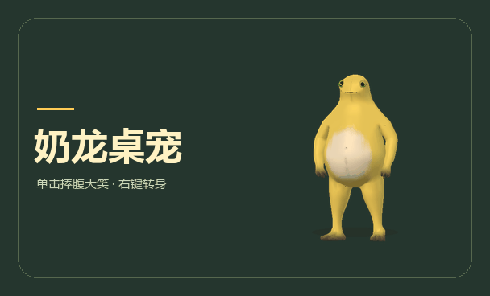

# 奶龙桌面宠物

把经典大笑款奶龙放到 Windows 桌面上。**左键点一下，它会闭眼咧嘴、双手捧腹、弯腰摇晃大笑。** 角色从独立的 3D 网格渲染，右键选「转个身」可以看到侧面和背面。



## 下载和使用

适用于 Windows 10 / 11，需要 .NET Framework 4.8 或更高版本。下载 `NailongDesktop.exe` 后双击即可运行。 [GitHub Releases](https://github.com/szwww2/NAILONG-DESKTOP/releases/latest)

| 操作 | 效果 |
| --- | --- |
| 左键单击奶龙 | 触发约 4.3 秒的捧腹大笑动作和笑声，随后回到待机。 |
| 按住左键拖动 | 移动桌宠，并记住位置。透明区域可以点到后面的窗口。 |
| 右键点击奶龙 | 可喂饼干、睡觉、转身、缩放或退出。 |
| 右键点击系统托盘里的奶龙图标 | 打开同一个菜单，可切换置顶、静音、散步和登录启动。 |
| 双击托盘图标 | 隐藏或显示奶龙。隐藏后再次运行 EXE 也能唤回原来的奶龙。 |

菜单里的「偶尔散步」开启后，奶龙会在当前屏幕的工作区短距离走动。「回到主屏幕右下角」可以重置位置。首次启动时开启置顶和笑声，登录启动需手动在菜单开启。开启登录启动后，移动 EXE 时可在新位置重新启用。

## 从源码构建

在 Windows PowerShell 中进入仓库目录，运行以下命令。构建脚本使用 Windows 自带的 .NET Framework C# 编译器，无需安装 NuGet 依赖。

```powershell
powershell.exe -NoProfile -ExecutionPolicy Bypass -File .\build.ps1
.\dist\NailongDesktop.exe
```

`PetWindow` 处理 WPF 逐像素透明窗口、拖动阈值、动画状态和托盘菜单。`PetModel` 载入嵌入 EXE 的网格、纹理和动画姿态，在 Windows 的 3D 视口中插值渲染。笑声音轨也内嵌在程序中，模型的张嘴幅度随声强变化。窗口隐藏时暂停渲染，位置和选项保存到 `%LOCALAPPDATA%\NailongDesktop\settings.xml`。

## 编辑 3D 模型

[model/nailong.blend](model/nailong.blend) 包含可编辑的网格、骨架、材质和脸部形态键。`Laugh jaw` 控制张嘴，`Squint` 控制眯眼。Blender 时间线上有 `Idle`、`Laugh`、`Feed`、`Sleep` 和 `Walk` 标记。渲染工具链和署名见 [model/README.md](model/README.md)。

## 参考

- 非官方同人桌宠。角色为第七印象的奶龙。 [第七印象](https://www.nailoong.com/business/ipIncubation/)
- 在 WeDai 的 Blender 模型基础上绑定骨骼、制作表情和动作。弯腰、捧腹、闭眼露齿以经典大笑表情包为动作参考。 [模型来源](https://github.com/bigdiu/naiwa-nailoong-blender-model) · [经典大笑参考](https://www.vgover.com/news/198094)
- 笑声取自 craigsmith 发布的 CC0 真人笑声《R16-04-Man Laughing.wav》，经过剪裁、变速和响度处理。 [录音与授权](https://freesound.org/people/craigsmith/sounds/482787/)
- 桌宠交互调研参考了 VPet 的陪伴与互动设计，透明窗口采用 WPF 的逐像素透明机制。 [VPet](https://github.com/LorisYounger/VPet) · [Microsoft Learn](https://learn.microsoft.com/en-us/dotnet/api/system.windows.window.allowstransparency)
